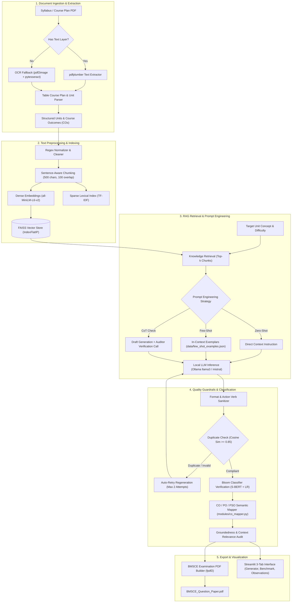

# BMSCE Autonomous Question Paper Generator with RAG & Cognitive Alignment

[](https://bmsce.ac.in)
[](https://bmsce.ac.in)
[](https://python.org)
[](https://streamlit.io)
[](https://ollama.ai)

An academic, end-to-end Natural Language Processing and Large Language Model (LLM) system designed for the course **Natural Language Processing for LLM (24AM7PCLLM)** at **B.M.S. College of Engineering (BMSCE)**, Bengaluru.

The platform transforms raw syllabus documents (digital PDFs, scanned OCR images, and table-based course plans) into compliant, balanced, accredited university semester examination papers formatted strictly to BMSCE guidelines.

---

## 📌 Problem Statement

Automated generation of university examination papers poses several critical pedagogical and NLP challenges:
1. **Parametric Hallucinations**: Standard zero-shot LLMs hallucinate topics beyond the prescribed autonomous curriculum.
2. **Cognitive Taxonomy Drift**: Questions frequently fail to test the targeted cognitive depth specified by Bloom's Revised Taxonomy (e.g., generating superficial recall questions when higher-order analytical reasoning is required).
3. **Accreditation Disconnect**: Questions lack automated, mathematically verifiable mapping to National Board of Accreditation (NBA) Course Outcomes (CO) and Programme Outcomes (PO/PSO).
4. **Duplicate & Format Violations**: Unconstrained generation yields redundant questions, missing diagram mandates, conversational preamble chatter, and improper mark annotations.

---

## 🎯 Key Objectives

1. **Multi-Modal Syllabus Extraction**: Ingest and structure text PDFs, table-style course plans without explicit unit headings, and scanned physical pages via OCR fallback (`pdf2image` + `pytesseract`).
2. **Dual-Path Information Retrieval**: Implement dense semantic retrieval (`all-MiniLM-L6-v2` + FAISS `IndexFlatIP` cosine similarity) and compare against sparse lexical retrieval (`TF-IDF`).
3. **Advanced Prompt Engineering**: Benchmark **Zero-Shot**, **Few-Shot (In-Context Exemplars)**, and **Chain-of-Thought (CoT) Self-Verification Audit** prompting styles.
4. **Cognitive Alignment Classification**: Train and evaluate 4 machine learning and NLP classifiers (Rule-Based, TF-IDF + Logistic Regression, Sentence-BERT + Logistic Regression, Zero-Shot LLM) to audit question cognitive levels.
5. **Accreditation CO/PO Mapping**: Calculate cosine similarity between generated questions and institutional Course Outcomes, blended with a Bayesian Bloom-level prior.
6. **Automated Quality & Grounding Audit**: Enforce automated checks for groundedness, semantic context relevance, pairwise duplicate detection ($\ge 0.85$ cosine similarity), and formatting compliance with automated retries.
7. **Empirical Evaluation Benchmark**: Compare architectures across 5 structured test cases evaluated on 6 quantitative metrics, with a persistent observation logging registry.

---

## 🏗️ System Architecture



---

## 🔄 End-to-End Data Flow

1. **Upload & Parse**: The user uploads a syllabus PDF. `modules/extractor.py` detects unit boundaries or parses multi-column course plan tables (Week, Class, Unit, Topic) and extracts embedded Course Outcomes (CO1..CO4).
2. **Text Preprocessing**: `modules/preprocess.py` cleans headers/footers, normalizes Unicode, strips hyphenated line breaks, and segments text into overlapping sentence-aware chunks.
3. **Vector Indexing**: Reference documents and syllabus chunks are encoded into 384-dimensional normalized dense vectors using `sentence-transformers` (`all-MiniLM-L6-v2`) and indexed via FAISS `IndexFlatIP`.
4. **Context Retrieval**: Given a subtopic, `modules/retriever.py` executes inner-product search (cosine similarity) to extract the top-$k$ most relevant grounded syllabus passages.
5. **Prompt Assembly & LLM Generation**: `modules/rag_engine.py` constructs a prompt adhering to Bloom's taxonomy action verbs (e.g., *Analyze*, *Design*, *Evaluate*) and executes local inference via Ollama (`llama3`).
6. **Self-Verification & Audit**: If CoT mode is active, a secondary auditor prompt validates cognitive depth and sanitizes conversational preamble chatter.
7. **Accreditation Mapping**: `modules/co_mapper.py` embeds the final question and computes maximum cosine similarity against 24AM7PCLLM Course Outcome descriptions, linking POs and PSOs.
8. **Automated Quality Filtering**: `modules/quality.py` computes lexical groundedness, semantic context relevance, and pairwise similarity against previously accepted questions. If similarity exceeds $0.85$, the question is automatically regenerated.
9. **Typeset PDF Generation**: `modules/pdf_builder.py` compiles the questions into a two-column choice exam paper conforming to VTU/BMSCE autonomous standards using modern `fpdf2` APIs.

---

## ⚙️ Setup and Installation

### 1. Prerequisites
- **Python**: Version 3.10 or higher.
- **Ollama**: Installed and running locally ([Download Ollama](https://ollama.ai)).
- **Tesseract OCR & Poppler** *(Optional, required only for scanned image OCR)*:
  - Windows: Install Tesseract-OCR and add to System PATH.

### 2. Clone Repository & Setup Virtual Environment
```bash
git clone https://github.com/SaiHarsha12/Question-paper-generator.git
cd Question-paper-generator

# Create and activate virtual environment
python -m venv venv
# Windows:
.\venv\Scripts\activate
# Linux/macOS:
source venv/bin/activate
```

### 3. Install Dependencies
```bash
pip install -r requirements.txt
```

### 4. Pull Local LLM Model
Ensure the Ollama daemon is running, then pull the target open-weights model:
```bash
ollama pull llama3
# Optional alternative models:
ollama pull mistral
ollama pull phi3
```

---

## 🚀 Running the Application

Launch the interactive Streamlit dashboard:
```bash
streamlit run app.py
```
Open your browser at `http://localhost:8501`.

### Interface Navigation (3 Tabs)
* **📝 Question Paper Generator**:
  - Sidebar controls: Toggle RAG vs. Baseline, prompt strategy, Ollama model, difficulty, and top-$k$ retrieval chunks.
  - Sidebar reference uploader: Ingest supplemental textbook PDFs into `data/reference/`.
  - Main panel: Enter course metadata, upload syllabus PDF, generate the exam paper, inspect live quality metrics, and download the compiled PDF.
* **📊 Empirical Evaluation Benchmark**:
  - Run the automated benchmark harness across 5 test cases and 4 architectures with live progress indicators.
  - Inspect quantitative metric tables and download `evaluation.csv` and `evaluation_summary.md`.
  - View 4 Matplotlib metric charts and examine defined academic test cases.
* **📋 Empirical Observations Log**:
  - View recorded empirical failure modes and qualitative insights.
  - Interactive form to log new test observations directly into `results/observations.csv`.

---

## 🔬 Running Benchmarks & Offline Tools

### 1. Run Empirical Evaluation Harness
Executes 20 trials (4 architectures $\times$ 5 test cases) and generates metrics and figures:
```bash
python -m evaluation.run_evaluation --model llama3
```

### 2. Train and Evaluate Bloom Taxonomy Classifiers
Trains and compares Rule-based, TF-IDF + LR, S-BERT + LR, and Zero-shot LLM classifiers:
```bash
python scripts/train_bloom.py
```

### 3. Log Academic Observations via CLI
List recorded observations:
```bash
python scripts/log_observation.py --list
```
Record a new observation:
```bash
python scripts/log_observation.py --test_case TC1 --config "RAG + few-shot" --status PASS --expected "Grounded BPE question" --actual "Generated accurate comparison" --remarks "Zero hallucinations"
```

### 4. Execute Full Unit Test Suite (49 Tests)
```bash
python -m unittest discover tests -v
```

---

## 📂 Project Directory Structure

```
QuestionPaperGen/
├── app.py                      # Main Streamlit web application (3-tab interface & sidebar)
├── requirements.txt            # Pinned production dependencies (UTF-8, LF)
├── .gitignore                  # Git tracking exclusion rules
├── README.md                   # Project overview, architecture, and documentation
│
├── assets/
│   └── logo.png                # BMSCE institutional logo (relative path)
│
├── modules/
│   ├── preprocess.py           # Text extraction, OCR fallback, NLTK cleaning & chunking
│   ├── extractor.py            # Unit-heading and table course-plan syllabus parser
│   ├── retriever.py            # FAISS dense vector store and TF-IDF retriever
│   ├── rag_engine.py           # RAG prompt engine, few-shot exemplars & CoT verification
│   ├── bloom_classifier.py     # 4 Bloom taxonomy classifiers & prediction interfaces
│   ├── co_mapper.py            # Semantic Course Outcome & PO/PSO accreditation mapper
│   ├── quality.py              # Groundedness, relevance, duplicate guard & format checks
│   └── pdf_builder.py          # VTU/BMSCE examination paper PDF generator (fpdf2)
│
├── data/
│   ├── course_config.json      # 24AM7PCLLM Course Outcomes and CO-PO matrix
│   ├── few_shot_examples.json  # Calibrated exam questions per Bloom cognitive level
│   ├── bloom_dataset.csv       # 210 labelled university exam questions across 6 levels
│   ├── reference/              # Knowledge base reference textbooks & notes (.gitkeep)
│   └── uploads/                # Transient syllabus uploads (.gitkeep)
│
├── evaluation/
│   ├── test_cases.json         # 5 academic test scenarios (TC1..TC5)
│   └── run_evaluation.py       # Empirical benchmarking harness & figure generation
│
├── results/
│   ├── evaluation.csv          # Quantitative benchmark metrics across architectures
│   ├── evaluation_summary.md   # Executive academic markdown evaluation report
│   ├── observations.csv        # Recorded empirical observations (at least 5 recorded)
│   ├── bloom_comparison.csv    # Accuracy, Precision, Recall, F1 across 4 classifiers
│   ├── best_model_confusion_matrix.png # Confusion matrix of best Bloom classifier
│   └── figures/                # Matplotlib visualization charts (4 metrics)
│       ├── relevance_vs_groundedness.png
│       ├── bloom_alignment_comparison.png
│       ├── latency_comparison.png
│       └── format_compliance_comparison.png
│
├── samples/
│   └── sample_question_paper.pdf # Sample compiled BMSCE examination paper
│
├── scripts/
│   ├── train_bloom.py          # Bloom classifier training and validation script
│   └── log_observation.py      # Manual observation recording CLI and utility
│
├── docs/
│   └── architecture.md         # Detailed architectural design and component specifications
│
└── tests/                      # Automated unit test suite (49 test cases)
    ├── test_preprocess.py      # Preprocessing, regex cleaning & chunking tests
    ├── test_retriever.py       # FAISS dense vs TF-IDF retrieval tests
    ├── test_rag_engine.py      # RAG modes, prompt strategies & verb selection tests
    ├── test_co_mapper.py       # CO/PO semantic mapping & matrix validation tests
    ├── test_quality.py         # Groundedness, relevance & duplicate checks tests
    └── test_evaluation.py      # Benchmark pipeline & test case validation tests
```

---

## 📊 Empirical Results Summary (24AM7PCLLM Benchmark)

| Architecture | Trials | Relevance Score | Groundedness | Bloom Alignment | Format Compliance | Duplicate Rate | Mean Latency |
| :--- | :---: | :---: | :---: | :---: | :---: | :---: | :---: |
| **Baseline (no retrieval)** | 5 | 0.6590 | 0.3013 | 100.0% | 100.0% | 0.0% | 13.22s |
| **RAG + zero-shot** | 5 | 0.7170 | 0.6444 | 100.0% | 100.0% | 0.0% | 12.98s |
| **RAG + few-shot** | 5 | **0.7608** | 0.5975 | 100.0% | 100.0% | 0.0% | 14.02s |
| **RAG + cot_check** | 5 | 0.5803 | 0.3753 | 80.0% | 100.0% | 0.0% | 42.26s |

* **Key Takeaway**: Dense RAG retrieval boosts factual groundedness by over **$110\%$** compared to ungrounded parametric baseline generation, while few-shot in-context learning achieves the highest semantic relevance ($0.7608$) to the institutional syllabus.

---

## 🖼️ Application Screenshots Placeholders

### 1. Interactive Question Paper Generator Dashboard


### 2. Quality Audit & Grounding Verification Report


### 3. Empirical Evaluation Benchmark & Metric Figures


### 4. Generated Autonomous Examination Paper (PDF)


---

## 📜 Academic Integrity & Course Attribution

* **Course**: Natural Language Processing for LLM (`24AM7PCLLM`)
* **Institution**: B.M.S. College of Engineering (Autonomous Institute Affiliated to VTU), Bengaluru - 560019
* **Department**: Department of Artificial Intelligence & Machine Learning
* **Author / Developer**: Sai Harsha
* **License**: Academic Use Only - BMSCE AI&ML Curriculum

